# MX Dev Kit

[English](README.md) | **Français**

Le kit des développeurs pour les périphériques Logitech MX, sur macOS et Windows. Des bulles d'Actions Ring pour votre dépôt (CI, PR, git) et une MX Master 4 qui vibre quand votre agent de code a fini.

**Projet non officiel, sans lien avec Logitech.**

[](https://github.com/lesjoiesducode/mx-dev-kit/actions/workflows/ci.yml)
[](LICENSE)


Un plugin pour l'Actions Ring de Logitech qui affiche l'état du dépôt sur lequel vous travaillez : CI, issues, pull requests, failles, modifications à committer, commits à pousser ou à récupérer. Chaque bulle est aussi un bouton, et un clic lance Claude Code, Codex, Gemini CLI ou Copilot CLI dans le projet. Avec une MX Master 4, la souris vibre quand la CI se termine, quand votre agent a fini ou quand un conteneur tombe.


## Ce qu'il fait

- **Des bulles de projet** qui suivent le dépôt de votre dernière commande dans le terminal ou de la fenêtre du Finder au premier plan (l'Explorateur de fichiers sous Windows) : nom et branche, issues et pull requests ouvertes, tous les checks du dernier commit, failles connues.
- **Git depuis l'anneau.** Commit de toutes les modifications, push, pull. Le push n'est jamais forcé et le pull ne fait que de l'avance rapide. Une IA en ligne de commande peut rédiger le message de commit. Le commit refuse de partir pendant un conflit de merge ou si un fichier secret comme `.env` s'y glisse, et demande un second clic sur la branche principale.
- **Les agents de code en un clic.** Claude Code, Codex, Gemini CLI et Copilot CLI ont chacun leur bulle à leur logo, qui ouvre dans le dépôt le terminal où vous travaillez (Terminal, iTerm, Ghostty, Warp ; Windows Terminal ou PowerShell) et y lance l'agent. **Agent dans le projet** fait la même chose avec la commande de votre choix.
- **Une boîte GitHub** pour tous vos dépôts : revues demandées, mentions, assignations, PR approuvées, fusionnées, avec des changements demandés ou des checks en échec. Chaque événement fait vibrer la souris et affiche une notification cliquable.
- **Les failles de n'importe quelle stack** avec osv-scanner, ou `npm audit` si osv-scanner n'est pas installé. Rien n'est jamais corrigé à votre place.
- **Un minuteur focus** : 25 minutes de travail, puis 5 minutes de pause.
- **Des hooks pour les agents de code.** Claude Code, Codex CLI, Gemini CLI et GitHub Copilot CLI font vibrer la souris quand ils ont fini un tour d'au moins 30 secondes, quand ils vous attendent ou quand ils plantent.
- **L'intégration au terminal** pour zsh, bash, fish et PowerShell. Toute commande de plus de 30 secondes vibre à la fin.
- **`uptime-watch`** pour surveiller des sites, des endpoints de santé et des ports locaux, **`docker-watch`** pour les conteneurs de votre stack compose.
- **`haptic`** et **`mx-notify`** pour faire vibrer la souris ou afficher une notification cliquable depuis vos propres scripts.

## Prérequis

- [Logi Options+](https://www.logitech.com/fr-fr/software/logi-options-plus) sur macOS ou Windows 10/11. Il installe Logi Plugin Service 6.4 ou plus récent, qui fait tourner le plugin.
- Un périphérique Logitech qui ouvre l'Actions Ring. Les vibrations demandent une **MX Master 4**, le seul modèle doté d'un moteur haptique.
- Le [Haptic Web Plugin](https://github.com/Fallstop/HapticWebPlugin), gratuit, de Jasper M-W (licence MIT), pour les vibrations des hooks, du terminal et des scripts de surveillance. L'installeur propose de l'installer pour vous, sinon il est sur le Marketplace d'Options+. Les vibrations propres au plugin s'en passent.

Certaines fonctions s'appuient sur un outil que vous avez peut-être déjà. Sans lui, la fonction reste éteinte et le reste marche.

| Outil | Active |
|---|---|
| Git | Les bulles de projet |
| [GitHub CLI](https://cli.github.com), après `gh auth login` | Les bulles GitHub, la boîte GitHub, `ci-watch`. github.com uniquement. L'installeur propose de l'installer (Homebrew, winget) et de vous connecter. |
| [osv-scanner](https://google.github.io/osv-scanner/) | Les failles de tous les fichiers de verrouillage. Sans lui, seulement les projets npm. |
| Docker | `docker-watch` |
| [terminal-notifier](https://github.com/julienXX/terminal-notifier), macOS | Des notifications qui ouvrent une page quand on clique dessus |

## Installation

Rien à compiler. Logi Options+ suffit.

```sh
# macOS
curl -fsSL https://github.com/lesjoiesducode/mx-dev-kit/releases/latest/download/install.sh | sh
```

```powershell
# Windows
irm https://github.com/lesjoiesducode/mx-dev-kit/releases/latest/download/install.ps1 | iex
```

1. **Lancez l'installeur.** Il pose une question par brique (le plugin Actions Ring, les vibrations des agents de code, l'intégration au terminal) ; Entrée vaut oui. Si GitHub CLI manque ou n'est pas connecté, il propose de l'installer et de vous connecter, pour les bulles GitHub.
2. **Donnez au Finder son propre anneau (conseillé).** Par défaut, Options+ applique un anneau à toutes les applications : vos actions habituelles laisseraient la place à git. Réservez plutôt l'anneau de dev à l'endroit où vous ouvrez vos projets : dans Options+, ouvrez votre périphérique, ajoutez une application et allez chercher `/System/Library/CoreServices/Finder.app` (dans la fenêtre de sélection, Cmd+Maj+G permet de taper le chemin). Sous Windows, l'Explorateur de fichiers est `C:\Windows\explorer.exe`. Ajoutez de la même façon votre terminal ou votre éditeur si vous voulez aussi l'anneau dedans. Les bulles suivent le dossier de la fenêtre du Finder ou de l'Explorateur au premier plan, et celui de votre dernière commande dans le terminal.
3. **Remplissez l'anneau.** Dans Options+, ouvrez votre périphérique, choisissez cette application, puis **Actions Ring**, et glissez des actions de **MX Dev Kit** sur un anneau. Pour commencer : **Projet**, **CI du projet**, **PR du projet**, **Commit du projet**, **Push du projet**, **Pull du projet**, la bulle de votre agent de code et **Boîte GitHub**.
4. **Si une bulle n'affiche que son nom**, cliquez sur le crayon de son icône, réinitialisez l'icône avec la flèche circulaire au-dessus de l'aperçu, puis appliquez et enregistrez. Une fois suffit pour cette bulle.

Ouvrez ensuite un nouveau terminal, placez-vous dans un dépôt et lancez `haptic completed` pour vérifier la vibration.

<details>
<summary>N'installer que certaines briques</summary>

`--only` choisit les briques sans poser de question, `--yes` installe tout. Pour les seules vibrations des agents :

```sh
curl -fsSL https://github.com/lesjoiesducode/mx-dev-kit/releases/latest/download/install.sh | sh -s -- --only hooks
```

Sous Windows : `& ([scriptblock]::Create((irm https://github.com/lesjoiesducode/mx-dev-kit/releases/latest/download/install.ps1))) -Only hooks`. Les briques s'appellent `plugin`, `hooks` et `shell`.

</details>

<details>
<summary>Ce que fait l'installeur, et comment éviter de lancer un script par un pipe</summary>

Les téléchargements sont vérifiés avec `SHA256SUMS`. Les fichiers vont dans `~/.config/mx-dev-kit`, ou `%APPDATA%\mx-dev-kit` sous Windows, et chaque fichier modifié par l'installeur est d'abord sauvegardé.

L'intégration au terminal va là où votre shell la lit. zsh : `~/.zshrc`, ou `$ZDOTDIR/.zshrc`. bash : `~/.bash_profile`, ou le `~/.bash_login` ou `~/.profile` que vous avez déjà. fish : un fichier à part, `~/.config/fish/conf.d/mx-dev-kit.fish`. Windows : `profile.ps1`, que chargent tous les hôtes (console, Windows Terminal, VS Code), pour Windows PowerShell et pour PowerShell 7 s'il est installé, dans votre dossier Documents où que Windows le range (OneDrive compris). Un autre shell : l'installeur le dit, n'écrit rien, et donne la ligne à ajouter à la main.

Si vous préférez ne pas envoyer un script directement dans votre shell, téléchargez `mx-dev-kit.zip` depuis la [dernière release](https://github.com/lesjoiesducode/mx-dev-kit/releases/latest) et lancez `./install.sh` depuis l'archive.

Pour ajouter le plugin à la main, téléchargez [MxDevKit.lplug4](https://github.com/lesjoiesducode/mx-dev-kit/releases/latest/download/MxDevKit.lplug4), ouvrez le gestionnaire de plugins d'Options+ (réglages du retour haptique, **Install and uninstall plugins** dans l'interface en anglais) et double-cliquez sur le fichier pendant que cette fenêtre est ouverte. Sans elle, le double-clic ne fait rien.

</details>

<details>
<summary>Haptic Web Plugin</summary>

Avec les vibrations des agents ou l'intégration au terminal, l'installeur propose aussi d'installer le [Haptic Web Plugin](https://github.com/Fallstop/HapticWebPlugin) de Jasper M-W (licence MIT), par lequel passent leurs vibrations. Il télécharge `HapticWeb.lplug4` depuis la dernière release de ce projet, vérifie qu'il s'agit bien du Haptic Web Plugin et demande à Logi Plugin Service de le charger. `--yes` et `--only` l'installent sans demander, `--no-haptic-web` (`-NoHapticWeb` sous Windows) le saute sans demander.

S'il est déjà installé, depuis le Marketplace ou ailleurs, il reste tel quel et n'est jamais remplacé. Si quelque chose coince (hors ligne, GitHub indisponible, Logi Options+ absent, paquet refusé), le reste du kit s'installe quand même et l'installeur vous renvoie vers le Marketplace d'Options+. L'installeur Windows fait de même.

</details>

<details>
<summary>Hooks Codex et anneau</summary>

Codex ignore les nouveaux hooks tant que vous ne les avez pas approuvés : ouvrez Codex une fois et tapez `/hooks`.

L'anneau par défaut s'affiche dans toutes les applications qui n'ont pas le leur. Un anneau a 8 emplacements pour 16 bulles.

</details>

### Garde-fous du commit

La bulle **Commit du projet** vérifie le dépôt avant de lancer `git add -A`. Quand elle refuse, rien n'est indexé ni écrit, la bulle affiche **Échec** et une notification donne le nom des fichiers.

- **Conflit de merge.** Des fichiers en conflit, un merge, un rebase, un cherry-pick ou un revert pas terminé, ou des marqueurs de conflit (`<<<<<<<`, `>>>>>>>`) dans des lignes ajoutées : refusé.
- **Fichier secret.** Un fichier non ignoré qui partirait dans le commit : `.env` et `.env.*` (sauf `.env.example`, `.env.sample`, `.env.template` et `.env.dist`), `*.pem`, `*.key`, `*.p12`, `*.pfx`, les clés SSH privées comme `id_rsa`, `credentials.json`, `.netrc` et quelques autres. Refusé, avec le conseil de l'ajouter au `.gitignore`. Pour le committer malgré tout, passez par un terminal.
- **Branche principale.** Sur `main`, `master` ou la branche par défaut d'`origin`, le premier clic transforme la bulle en **Confirmer ?** et affiche une notification. Un second clic dans les 5 secondes committe. Sinon, la bulle revient à son état normal.

Le plugin lance `git status` toutes les quelques secondes sans verrou optionnel : il ne bloque jamais `.git/index.lock` pendant que vous committez ou rebasez dans un terminal.

## L'Actions Ring des développeurs

Les bulles se mettent à jour toutes seules. GitHub est interrogé toutes les 60 secondes, toutes les 15 pendant que des checks tournent et pendant les deux minutes qui suivent un push. `git fetch` passe toutes les 3 minutes pour la bulle Pull.


| | Bulle | Affiche | Clic |
|---|---|---|---|
| 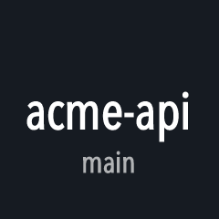 | Projet | Dépôt et branche | Ouvre le dépôt sur GitHub, sinon le dossier |
|  | Issues du projet | Issues ouvertes | Ouvre la liste |
| 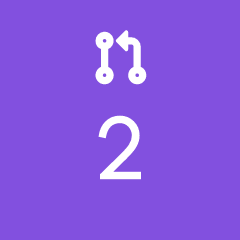 | PR du projet | Pull requests ouvertes | Ouvre la liste |
| 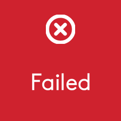 | CI du projet | Tous les checks du dernier commit de la branche : tous les workflows, et les services qui publient leur statut sur GitHub (Vercel, Netlify, CircleCI...). Rouge dès qu'un seul échoue, vibre à la fin | Ouvre celui en échec, ou le run |
|  | Failles du projet | Failles de gravité high et critical par défaut | Relance l'analyse |
| 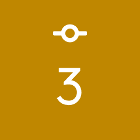 | Commit du projet | Fichiers modifiés | `git add -A` et commit, avec des [garde-fous](#garde-fous-du-commit) |
| 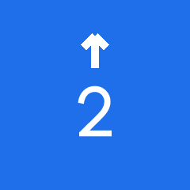 | Push du projet | Commits à pousser | `git push`, publie une nouvelle branche |
|  | Pull du projet | Commits à récupérer | `git pull --ff-only` |
|  | Claude Code | | Lance `claude` dans un terminal, dans le projet |
| 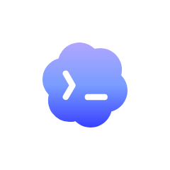 | Codex | | Lance `codex` |
|  | Gemini CLI | | Lance `gemini` |
|  | Copilot CLI | | Lance `copilot` |
| 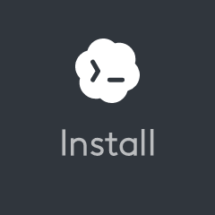 | | L'agent n'est pas installé | Ouvre sa page d'installation |
| 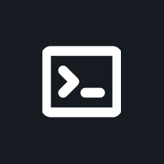 | Agent dans le projet | | Lance `agent.command` (`claude` par défaut), pour tout autre agent ou outil |
| 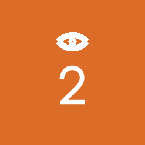 | Revues demandées | Pull requests qui attendent votre revue | Les ouvre |
| 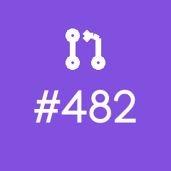 | Boîte GitHub | Dernier événement GitHub qui vous concerne | L'ouvre |
|  | Minuteur focus | Temps restant | Lance ou arrête |

Les noms sont ceux qu'affiche Options+ quand le plugin est en français ; les images ci-dessus sont celles de la version anglaise.

Pour essayer une bulle sans la souris, écrivez son nom dans le fichier de déclenchement : `echo commit > ~/.config/mx-dev-kit/trigger`. Il accepte aussi `push`, `pull`, `agent`, `claude`, `codex`, `gemini`, `copilot`, `audit`, `focus`, `inbox`, `notify` et `inbox-test`.

## Scripts

Les scripts sont dans votre PATH dès que l'intégration au terminal est chargée :

```sh
haptic completed                       # joue une vibration. haptic --list les montre toutes
./deploy.sh && haptic happy_alert || haptic angry_alert
mx-notify "Deploy done" "api 1.4.2 is live" https://example.com/status
buzz make test                         # vibre à la fin de cette commande, quelle que soit sa durée
git push && ci-watch                   # vibre quand les runs Actions de HEAD sont terminés
uptime-watch https://example.com http://localhost:3000/health localhost:5432
docker-watch                           # conteneurs du projet compose de ce dossier, --all pour tous
touch ~/.config/mx-dev-kit/haptics.off   # coupe toutes les vibrations, supprimez le fichier pour les rétablir
```

Les options et les façons de les lancer en tâche de fond sont dans [bin/](bin/), [shell/](shell/) et [hooks/](hooks/) (en anglais). Sous Windows, les scripts se terminent par `.ps1`.

## Configuration

Tout est facultatif. L'installeur crée `~/.config/mx-dev-kit/config.json` à partir de [config.example.json](config.example.json), où chaque clé est commentée. Le plugin relit le fichier dès que vous l'enregistrez. Les réglages que vous changerez le plus probablement :

```jsonc
{
  "agent": { "terminal": "iTerm", "commands": { "codex": "codex --full-auto" }, "command": "aider", "label": "Aider" },
  "commit": { "messageCommand": ["claude", "-p", "{prompt}", "--model", "haiku"] },
  "audit": { "minSeverity": "moderate" },
  "github": { "events": { "teamMention": false } },
  "tools": { "gh": "/opt/homebrew/bin/gh" }
}
```

`agent.terminal` vaut `auto` par défaut : les bulles d'agent ouvrent le terminal de votre dernière commande, Terminal, iTerm, Ghostty (1.3 ou plus récent) ou Warp, et sous Windows Windows Terminal ou une fenêtre PowerShell. Le terminal de VS Code ne peut pas être ouvert de l'extérieur : depuis VS Code, l'agent s'ouvre dans Terminal (Windows Terminal sous Windows). Réglez `agent.terminal` pour en imposer un, ou `agent.launch` pour tout autre terminal. Les deux valent pour toutes les bulles d'agent. `agent.commands` change la ligne de commande de la bulle Claude Code, Codex, Gemini CLI ou Copilot CLI ; `agent.command` et `agent.label` sont ceux d'**Agent dans le projet**. `commit.messageCommand` reçoit le diff indexé sur son entrée standard. Sans lui, ou s'il échoue, le message est construit à partir de la liste des fichiers, du genre "Update app.ts, api.ts and 3 more files". `tools` ne sert que si le plugin ne trouve pas un outil, car il ne voit pas le PATH de votre shell.

## Langues

Le plugin parle anglais et français. Avec `"language": "auto"`, il suit la première langue préférée de votre compte macOS, ou la langue d'affichage de Windows : français si elle commence par `fr`, anglais sinon. Mettez `"en"` ou `"fr"` pour l'imposer, puis redémarrez le plugin pour que les noms des actions changent dans Options+. Les scripts, les hooks et les installeurs sont en anglais.

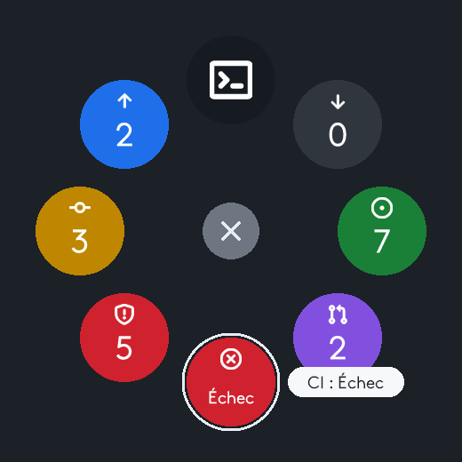

## Dépannage

- **Une bulle affiche son nom au lieu d'une image.** Réinitialisez son icône une fois, comme indiqué à l'étape 3 de l'[installation](#installation).
- **MX Dev Kit n'apparaît pas dans Options+.** Ouvrez les réglages d'Options+ et redémarrez Logi Plugin Service (**Restart Logi Plugin Service**).
- **Une bulle d'agent affiche Installer alors que l'agent est installé.** Le plugin ne voit pas le PATH de votre shell. Indiquez son chemin dans `tools`, par exemple `"tools": { "codex": "/Users/vous/.npm-global/bin/codex" }`.
- **Les bulles GitHub affichent `–`.** Le dépôt n'a pas de remote GitHub `origin`, ou `gh` est absent ou pas connecté. Lancez `gh auth login`.
- **Aucune vibration.** Seule la MX Master 4 vibre. Vérifiez les réglages haptiques dans Options+ et que `haptics.off` n'existe pas. Pour les scripts et les hooks, `haptic --list` dit si le Haptic Web Plugin répond.
- **`haptic` dit que le Haptic Web Plugin est injoignable.** Vérifiez qu'il est installé : un dossier `HapticWeb` dans `~/Library/Application Support/Logi/LogiPluginService/Plugins` (`%LOCALAPPDATA%\Logi\LogiPluginService\Plugins` sous Windows). S'il y est, redémarrez Logi Plugin Service depuis les réglages d'Options+, puis relancez `haptic --list`. S'il n'y est pas, relancez l'installeur ou installez-le depuis le Marketplace d'Options+.

Le journal du plugin est `~/Library/Application Support/Logi/LogiPluginService/Logs/plugin_logs/MxDevKit.log` sur macOS et `%LOCALAPPDATA%\Logi\LogiPluginService\Logs\plugin_logs\MxDevKit.log` sous Windows.

## Questions fréquentes

**Avec quels périphériques ?** Les bulles demandent un périphérique Logitech qui ouvre l'Actions Ring dans Logi Options+. Logitech le propose sur ses souris et claviers MX, comme la MX Master 4 et le MX Keys S, avec Logi Options+ 1.83 ou plus récent ([la page de Logitech](https://www.logitech.com/fr-fr/software/logi-options-plus/actions-ring.html)). Les vibrations demandent une MX Master 4, la seule équipée d'un moteur haptique. Le kit est testé avec une MX Master 4.

**GitLab, Bitbucket, GitHub Enterprise ?** Pas encore. Les bulles git (projet, commit, push, pull) marchent avec n'importe quel remote, mais les bulles GitHub, la boîte GitHub et `ci-watch` ne connaissent que github.com.

**Qu'est-ce qui sort de ma machine ?** Le kit n'a ni serveur, ni compte, ni télémétrie. Ce qui sort, c'est ce que vos propres outils envoient quand le kit les lance :

- `gh`, connecté avec votre compte, pour les bulles GitHub et la boîte GitHub ;
- `git fetch` vers votre remote toutes les 3 minutes, pour la bulle Pull (`git.fetchMinutes`, 0 pour l'arrêter) ;
- l'analyse des failles : osv-scanner envoie les noms et versions de vos dépendances à [OSV.dev](https://osv.dev), `npm audit` les envoie au registre npm (`audit.enabled` pour la couper) ;
- le diff indexé, seulement si vous réglez `commit.messageCommand`, vers la commande que vous avez choisie ;
- les installeurs téléchargent depuis les releases de ce dépôt et de celui du Haptic Web Plugin.

Les vibrations restent sur l'ordinateur : les hooks et les scripts parlent au Haptic Web Plugin sur `127.0.0.1`.

**Pourquoi macOS demande-t-il si Logi Plugin Service peut contrôler le Finder ?** Pour suivre le projet de la fenêtre du Finder au premier plan, le plugin demande son dossier au Finder par AppleScript. Refusez, ou mettez `"followFinder": false`, et le projet ne suivra plus que votre terminal. La même demande pour Terminal, iTerm ou Ghostty vient des bulles d'agent, qui ouvrent une fenêtre de terminal et y tapent la commande de l'agent.

## Désinstallation

```sh
~/.config/mx-dev-kit/uninstall.sh          # --purge supprime aussi config.json
```

```powershell
powershell -ExecutionPolicy Bypass -File "$env:APPDATA\mx-dev-kit\uninstall.ps1"   # -Purge supprime aussi config.json
```

Il retire le plugin, la ligne du profil du shell, les hooks et les scripts, et garde une sauvegarde de chaque fichier qu'il modifie. Le Haptic Web Plugin reste en place, puisque d'autres outils peuvent s'en servir : désinstallez-le depuis Options+ si vous n'en avez pas besoin.

## Compiler depuis les sources

Seulement pour contribuer. Il vous faut le [SDK .NET 10](https://dotnet.microsoft.com/download/dotnet/10.0).

```sh
git clone https://github.com/lesjoiesducode/mx-dev-kit.git
cd mx-dev-kit
dotnet build MxDevKit.slnx
dotnet test tests/MxDevKit.Core.Tests
sh tests/shell/run.sh                        # scripts et installeurs, avec de faux outils
./install.sh --link --only plugin            # charge votre build Debug dans Logi Plugin Service
```

La logique vit dans `src/MxDevKit.Core`, avec ses tests. `src/MxDevKitPlugin` est la fine couche qui parle au SDK. Les releases et le reste sont dans [CONTRIBUTING.md](CONTRIBUTING.md) (en anglais).

## Crédits et licence

Construit sur le [Logi Actions SDK](https://logitech.github.io/actions-sdk-docs/). Les vibrations des scripts passent par le [Haptic Web Plugin](https://github.com/Fallstop/HapticWebPlugin) de Jasper M-W, licence MIT. Les installeurs le téléchargent depuis ses propres releases ; il ne fait pas partie de ce dépôt. Les pictogrammes des bulles sont les [Primer octicons](https://primer.style/octicons) de GitHub, licence MIT. Les logos des agents viennent de [Simple Icons](https://simpleicons.org) (Claude ; GitHub Copilot vient des [Primer octicons](https://primer.style/octicons) de GitHub) et de [Lobe Icons](https://github.com/lobehub/lobe-icons) (Codex, Gemini).

Logitech, Logi, MX Master, Logi Options+ et Actions Ring sont des marques de Logitech. Claude et Claude Code sont des marques d'Anthropic, Codex d'OpenAI, Gemini de Google, GitHub Copilot de GitHub. Leurs logos servent uniquement à désigner l'outil que lance chaque bulle.

[MIT](LICENSE) © 2026 [Les Joies du Code](https://lesjoiesducode.fr).
