# MX Dev Kit

**English** | [Français](README.fr.md)

Developer productivity kit for Logitech MX devices on macOS and Windows. Actions Ring bubbles for your repo (CI, PRs, git) and MX Master 4 vibrations when your coding agent finishes.

**Unofficial, not affiliated with Logitech.**

[](https://github.com/lesjoiesducode/mx-dev-kit/actions/workflows/ci.yml)
[](LICENSE)


A plugin for the Logitech Actions Ring that shows the state of the repository you are working on: CI, issues, pull requests, vulnerabilities, changes to commit, push or pull. Each bubble is also a button, and one click starts Claude Code, Codex, Gemini CLI or Copilot CLI in the project. On an MX Master 4, the mouse vibrates when your CI finishes, your coding agent is done or a container dies.


<sub>Drawn by the plugin's own code. In Logi Options+ the ring is smaller and opens around the cursor.</sub>

## Features

- **Project bubbles** that follow the repository of your last terminal prompt or of the front Finder window (File Explorer on Windows): name and branch, open issues, open pull requests, every check of the latest commit, known vulnerabilities.
- **Git from the ring.** Commit all changes, push, pull. Push never forces and pull only fast-forwards. An AI CLI can write the commit message. Commit refuses during a merge conflict or when a secret file such as `.env` would go in, and asks for a second click on the main branch.
- **Coding agents in one click.** Claude Code, Codex, Gemini CLI and Copilot CLI each have a bubble with their mark, which opens the terminal you work in (Terminal, iTerm, Ghostty, Warp; Windows Terminal or PowerShell) in the repository and starts the agent. **Agent in project** does the same with any command you set.
- **GitHub inbox** across all your repositories: review requests, mentions, assignments, approvals, merges, changes requested and failed checks on your pull requests. Each one vibrates and shows a notification you can click.
- **Vulnerabilities for any stack** with osv-scanner, or `npm audit` when osv-scanner is not installed. It never fixes anything.
- **Focus timer**, 25 minutes of work then a 5-minute break.
- **Coding agent hooks.** Claude Code, Codex CLI, Gemini CLI and GitHub Copilot CLI vibrate when they finish a turn of 30 seconds or more, wait for you or fail.
- **Shell integration** for zsh, bash, fish and PowerShell. Any command longer than 30 seconds vibrates when it ends.
- **`uptime-watch`** for websites, health endpoints and local ports, **`docker-watch`** for the containers of your compose stack.
- **`haptic`** and **`mx-notify`** to vibrate or show a clickable notification from your own scripts.

## Requirements

- [Logi Options+](https://www.logitech.com/en-us/software/logi-options-plus) on macOS or Windows 10/11. It brings Logi Plugin Service 6.4 or later, which runs the plugin.
- A Logitech device that opens the Actions Ring. Vibrations need an **MX Master 4**, the only device with a haptic motor.
- The free [Haptic Web Plugin](https://github.com/Fallstop/HapticWebPlugin) by Jasper M-W (MIT license), for the vibrations of the hooks, the shell and the watchers. The installer offers to install it for you, or you can get it from the Marketplace inside Options+. The plugin's own vibrations work without it.

Some features use a tool you may already have. Without it, that feature stays off and the rest works.

| Tool | Turns on |
|---|---|
| Git | The project bubbles |
| [GitHub CLI](https://cli.github.com), after `gh auth login` | GitHub bubbles, GitHub inbox, `ci-watch`. github.com only. |
| [osv-scanner](https://google.github.io/osv-scanner/) | Vulnerabilities for every lockfile. Without it, npm projects only. |
| Docker | `docker-watch` |
| [terminal-notifier](https://github.com/julienXX/terminal-notifier), macOS | Notifications that open a page when clicked |

## Install

Nothing to build. Logi Options+ is all you need.

```sh
# macOS
curl -fsSL https://github.com/lesjoiesducode/mx-dev-kit/releases/latest/download/install.sh | sh
```

```powershell
# Windows
irm https://github.com/lesjoiesducode/mx-dev-kit/releases/latest/download/install.ps1 | iex
```

1. **Run the installer.** It asks about each part (the Actions Ring plugin, the coding agent haptics, the terminal integration) and Enter means yes.
2. **Give the Finder a ring of its own (recommended).** Options+ applies a ring to every application by default, so your usual actions would make way for git. Keep the dev ring for the place where you open your projects instead: in Options+, open your device, add an application and browse to `/System/Library/CoreServices/Finder.app` (in the file dialog, Cmd+Shift+G lets you type the path). On Windows, the File Explorer is `C:\Windows\explorer.exe`. Add your terminal or your editor the same way if you want the ring there too. The bubbles follow the folder of the front Finder or File Explorer window, and that of your last terminal prompt.
3. **Fill the ring.** In Options+, open your device, select that application, then **Actions Ring**, and drag actions from **MX Dev Kit** onto a ring. A good start is **Project**, **CI status**, **Pull requests**, **Commit all changes**, **Push**, **Pull**, the bubble of your coding agent and **GitHub inbox**.
4. **Show the live images.** A new bubble first shows only its name. Click the pencil on its icon, reset the icon with the round arrow above the preview, then **Apply** and **Save**. You do this once per bubble.

Then open a new terminal, `cd` into a repository and run `haptic completed` to check the vibration.

<details>
<summary>Install only some parts</summary>

`--only` picks parts without asking, `--yes` installs everything. For the agent vibrations alone:

```sh
curl -fsSL https://github.com/lesjoiesducode/mx-dev-kit/releases/latest/download/install.sh | sh -s -- --only hooks
```

On Windows, the same is `& ([scriptblock]::Create((irm https://github.com/lesjoiesducode/mx-dev-kit/releases/latest/download/install.ps1))) -Only hooks`. The parts are `plugin`, `hooks` and `shell`.

</details>

<details>
<summary>What the installer does, and how to avoid piping a script</summary>

Downloads are checked against `SHA256SUMS`. Files go to `~/.config/mx-dev-kit`, or `%APPDATA%\mx-dev-kit` on Windows, and every file the installer edits is backed up first.

The terminal integration goes where your shell reads it. zsh: `~/.zshrc`, or `$ZDOTDIR/.zshrc`. bash: `~/.bash_profile`, or the `~/.bash_login` or `~/.profile` you already have. fish: a file of its own, `~/.config/fish/conf.d/mx-dev-kit.fish`. Windows: `profile.ps1`, which every host loads (console, Windows Terminal, VS Code), for Windows PowerShell and for PowerShell 7 when it is installed, in your Documents folder wherever Windows keeps it (OneDrive included). Another shell: the installer says so, writes nothing, and gives the line to add by hand.

If you would rather not pipe a script into your shell, download `mx-dev-kit.zip` from the [latest release](https://github.com/lesjoiesducode/mx-dev-kit/releases/latest) and run `./install.sh` from it.

To add the plugin by hand instead, download [MxDevKit.lplug4](https://github.com/lesjoiesducode/mx-dev-kit/releases/latest/download/MxDevKit.lplug4), open the plugins manager of Options+ (**Haptic feedback**, the settings popover, **Install and uninstall plugins**) and double-click the file while that window is open.

</details>

<details>
<summary>Haptic Web Plugin</summary>

With the agent haptics or the terminal integration, the installer also offers to install the [Haptic Web Plugin](https://github.com/Fallstop/HapticWebPlugin) by Jasper M-W (MIT license), which their vibrations go through. It downloads `HapticWeb.lplug4` from the latest release of that project, checks that the package is the Haptic Web Plugin, and asks Logi Plugin Service to load it. `--yes` and `--only` install it without asking, `--no-haptic-web` (`-NoHapticWeb` on Windows) skips it without asking.

If it is already installed, from the Marketplace or elsewhere, it is left as it is, never replaced. If anything goes wrong (offline, GitHub unavailable, Logi Options+ missing, package refused), the rest of the kit installs anyway and the installer tells you to get it from the Marketplace in Options+ instead. The Windows installer does the same.

</details>

<details>
<summary>Codex hooks and the ring</summary>

Codex ignores new hooks until you trust them, so open Codex once and type `/hooks`.

The default ring shows in every app that has no ring of its own. The ring has 8 slots for 16 bubbles.

</details>

### Commit safeguards

The **Commit all changes** bubble checks the repository before it runs `git add -A`. When it says no, nothing is staged or written, the bubble shows **Failed** and a notification names the files.

- **Merge conflict.** Unmerged files, a merge, rebase, cherry-pick or revert that is not finished, or conflict markers (`<<<<<<<`, `>>>>>>>`) in new lines: refused.
- **Secret file.** A file that is not ignored and would be committed: `.env` and `.env.*` (but not `.env.example`, `.env.sample`, `.env.template` or `.env.dist`), `*.pem`, `*.key`, `*.p12`, `*.pfx`, SSH private keys such as `id_rsa`, `credentials.json`, `.netrc` and a few more. Refused, with a hint to add it to `.gitignore`. To commit it anyway, use a terminal.
- **Main branch.** On `main`, `master` or the default branch of `origin`, the first click turns the bubble into **Confirm?** and shows a notification. A second click within 5 seconds commits. Otherwise the bubble goes back to normal.

The plugin runs `git status` every few seconds without optional locks, so it never holds `.git/index.lock` while you commit or rebase in a terminal.

## Actions Ring for devs

The bubbles refresh on their own. GitHub is polled every 60 seconds, every 15 while checks run and for two minutes after a push. `git fetch` runs every 3 minutes for the Pull bubble.

| | Bubble | Shows | Click |
|---|---|---|---|
| 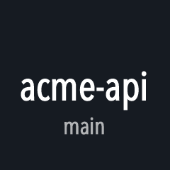 | Project | Repository and branch | Opens it on GitHub, or the folder |
|  | Issues | Open issues | Opens the list |
| 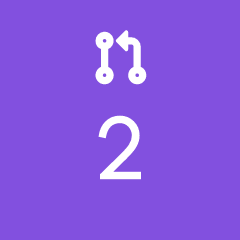 | Pull requests | Open pull requests | Opens the list |
| 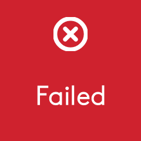 | CI status | Every check of the latest commit of the branch: all workflows, and the services that report to GitHub (Vercel, Netlify, CircleCI...). Red as soon as one fails, vibrates when they end | Opens the failing one, or the run |
|  | Vulnerabilities | High and critical advisories by default | Scans again |
| 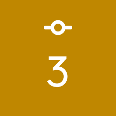 | Commit all changes | Changed files | `git add -A` and commit, with [safeguards](#commit-safeguards) |
| 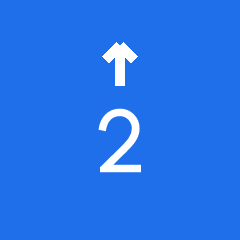 | Push | Commits to push | `git push`, publishes a new branch |
|  | Pull | Commits to pull | `git pull --ff-only` |
|  | Claude Code | | Starts `claude` in a terminal, in the project |
| 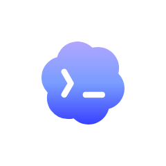 | Codex | | Starts `codex` |
| 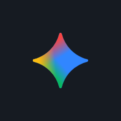 | Gemini CLI | | Starts `gemini` |
|  | Copilot CLI | | Starts `copilot` |
| 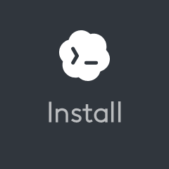 | | The agent is not installed | Opens its install page |
| 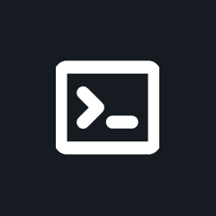 | Agent in project | | Starts `agent.command` (`claude` by default), for any other agent or tool |
| 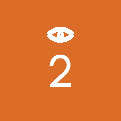 | Review requests | Pull requests waiting for your review | Opens them |
| 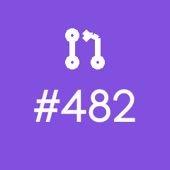 | GitHub inbox | Last GitHub event for you | Opens it |
|  | Focus timer | Time left | Starts or stops |

To try a bubble without the mouse, write its name to the trigger file: `echo commit > ~/.config/mx-dev-kit/trigger`. It also takes `push`, `pull`, `agent`, `claude`, `codex`, `gemini`, `copilot`, `audit`, `focus`, `inbox`, `notify` and `inbox-test`.

## Scripts

The scripts are on your PATH once the terminal integration is loaded:

```sh
haptic completed                       # play a waveform. haptic --list shows them all
./deploy.sh && haptic happy_alert || haptic angry_alert
mx-notify "Deploy done" "api 1.4.2 is live" https://example.com/status
buzz make test                         # vibrate when this command ends, whatever its duration
git push && ci-watch                   # vibrate when the Actions runs of HEAD are done
uptime-watch https://example.com http://localhost:3000/health localhost:5432
docker-watch                           # containers of the compose project in this folder, --all for every one
touch ~/.config/mx-dev-kit/haptics.off   # mute every vibration, delete the file to unmute
```

Options and background setups are in [bin/](bin/), [shell/](shell/) and [hooks/](hooks/). On Windows the scripts end in `.ps1`.

## Configuration

Everything is optional. The installer creates `~/.config/mx-dev-kit/config.json` from [config.example.json](config.example.json), where every key is commented. The plugin reloads the file when you save it. The settings you are most likely to change:

```jsonc
{
  "agent": { "terminal": "iTerm", "commands": { "codex": "codex --full-auto" }, "command": "aider", "label": "Aider" },
  "commit": { "messageCommand": ["claude", "-p", "{prompt}", "--model", "haiku"] },
  "audit": { "minSeverity": "moderate" },
  "github": { "events": { "teamMention": false } },
  "tools": { "gh": "/opt/homebrew/bin/gh" }
}
```

`agent.terminal` is `auto` by default: the agent bubbles open the terminal of your last prompt, Terminal, iTerm, Ghostty (1.3 or later) or Warp, and on Windows Windows Terminal or a PowerShell window. The terminal of VS Code cannot be opened from outside, so from VS Code the agent opens in Terminal (Windows Terminal on Windows). Set `agent.terminal` to force one, or `agent.launch` for any other terminal. Both apply to every agent bubble. `agent.commands` changes the command line of the Claude Code, Codex, Gemini CLI or Copilot CLI bubble; `agent.command` and `agent.label` are those of **Agent in project**. `commit.messageCommand` receives the staged diff on standard input. Without it, or if it fails, the message is built from the file list, like "Update app.ts, api.ts and 3 more files". `tools` is only needed when the plugin does not find a tool, because it does not see your shell's PATH.

## Languages

The plugin is in English and French. With `"language": "auto"` it follows the first preferred language of your macOS account, or the display language of Windows. French when it starts with `fr`, English otherwise. Set `"en"` or `"fr"` to force it, then restart the plugin so that the action names change in Options+. The scripts, hooks and installers are in English.

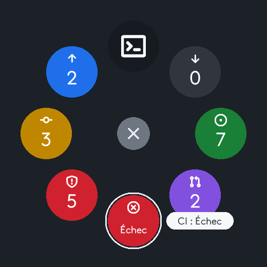

## Troubleshooting

- **A bubble shows its name instead of an image.** Reset its icon once, as described in step 3 of [Install](#install).
- **MX Dev Kit is not listed in Options+.** Open the Options+ settings and click **Restart Logi Plugin Service**.
- **An agent bubble says Install while the agent is installed.** The plugin does not see your shell's PATH. Set its path in `tools`, e.g. `"tools": { "codex": "/Users/you/.npm-global/bin/codex" }`.
- **GitHub bubbles show `–`.** The repository has no GitHub `origin` remote, or `gh` is missing or not signed in. Run `gh auth login`.
- **No vibration.** Only the MX Master 4 vibrates. Check the haptics settings in Options+ and that `haptics.off` does not exist. For the scripts and hooks, `haptic --list` tells you whether the Haptic Web Plugin answers.
- **`haptic` says the Haptic Web Plugin is unreachable.** Check that it is installed: a `HapticWeb` folder in `~/Library/Application Support/Logi/LogiPluginService/Plugins` (`%LOCALAPPDATA%\Logi\LogiPluginService\Plugins` on Windows). If it is there, restart Logi Plugin Service from the Options+ settings, then try `haptic --list` again. If it is not, run the installer again or install it from the Marketplace in Options+.

The plugin log is `~/Library/Application Support/Logi/LogiPluginService/Logs/plugin_logs/MxDevKit.log` on macOS and `%LOCALAPPDATA%\Logi\LogiPluginService\Logs\plugin_logs\MxDevKit.log` on Windows.

## FAQ

**Which devices work with it?** The bubbles need a Logitech device that opens the Actions Ring in Logi Options+. Logitech offers the Actions Ring on its MX mice and keyboards, such as the MX Master 4 and the MX Keys S, with Logi Options+ 1.83 or later ([Logitech's page](https://www.logitech.com/en-us/software/logi-options-plus/actions-ring.html)). Vibrations need an MX Master 4, the only one with a haptic motor. The kit is tested with an MX Master 4.

**GitLab, Bitbucket, GitHub Enterprise?** Not yet. The git bubbles (project, commit, push, pull) work with any remote, but the GitHub bubbles, the inbox and `ci-watch` only know github.com.

**What leaves my machine?** The kit has no server, no account and no telemetry. What goes out is what your own tools send when the kit runs them:

- `gh`, signed in with your account, for the GitHub bubbles and the inbox;
- `git fetch` to your remote every 3 minutes, for the Pull bubble (`git.fetchMinutes`, 0 to stop it);
- the vulnerability scan: osv-scanner sends the names and versions of your dependencies to [OSV.dev](https://osv.dev), `npm audit` sends them to the npm registry (`audit.enabled` to turn it off);
- the staged diff, only if you set `commit.messageCommand`, to the command you chose;
- the installers download from the releases of this repository and of the Haptic Web Plugin.

Vibrations stay on the computer: the hooks and scripts talk to the Haptic Web Plugin on `127.0.0.1`.

**Why does macOS ask whether Logi Plugin Service may control the Finder?** To follow the project of the front Finder window, the plugin asks the Finder for its folder through AppleScript. Refuse it, or set `"followFinder": false`, and the project follows your terminal only. The same kind of request for Terminal, iTerm or Ghostty comes from the agent bubbles, which open a terminal window and type the agent's command in it.

## Uninstall

```sh
~/.config/mx-dev-kit/uninstall.sh          # --purge also removes config.json
```

```powershell
powershell -ExecutionPolicy Bypass -File "$env:APPDATA\mx-dev-kit\uninstall.ps1"   # -Purge also removes config.json
```

It removes the plugin, the shell profile line, the hooks and the scripts, and keeps a backup of every file it edits. The Haptic Web Plugin stays, since other tools may use it: uninstall it from Options+ if you do not need it.

## Build from source

Only for contributors. You need the [.NET 10 SDK](https://dotnet.microsoft.com/download/dotnet/10.0).

```sh
git clone https://github.com/lesjoiesducode/mx-dev-kit.git
cd mx-dev-kit
dotnet build MxDevKit.slnx
dotnet test tests/MxDevKit.Core.Tests
sh tests/shell/run.sh                        # scripts and installers, with fake tools
./install.sh --link --only plugin            # load your Debug build in Logi Plugin Service
```

The logic lives in `src/MxDevKit.Core`, with its tests. `src/MxDevKitPlugin` is the thin layer that talks to the SDK. Releases and the rest are in [CONTRIBUTING.md](CONTRIBUTING.md).

## Credits and license

Built on the [Logi Actions SDK](https://logitech.github.io/actions-sdk-docs/). Script vibrations go through the [Haptic Web Plugin](https://github.com/Fallstop/HapticWebPlugin) by Jasper M-W, MIT license. The installers download it from its own releases; it is not part of this repository. The pictograms of the bubbles are GitHub's [Primer octicons](https://primer.style/octicons), MIT license. The agent marks come from [Simple Icons](https://simpleicons.org) (Claude, GitHub Copilot from GitHub's [Primer octicons](https://primer.style/octicons)) and [Lobe Icons](https://github.com/lobehub/lobe-icons) (Codex, Gemini).

Logitech, Logi, MX Master, Logi Options+ and Actions Ring are trademarks of Logitech. Claude and Claude Code are trademarks of Anthropic, Codex of OpenAI, Gemini of Google, GitHub Copilot of GitHub. Their marks only name the tool each bubble starts.

[MIT](LICENSE) © 2026 [Les Joies du Code](https://lesjoiesducode.fr).
